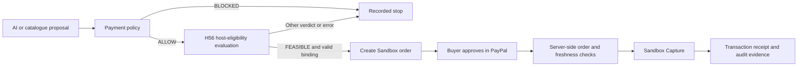
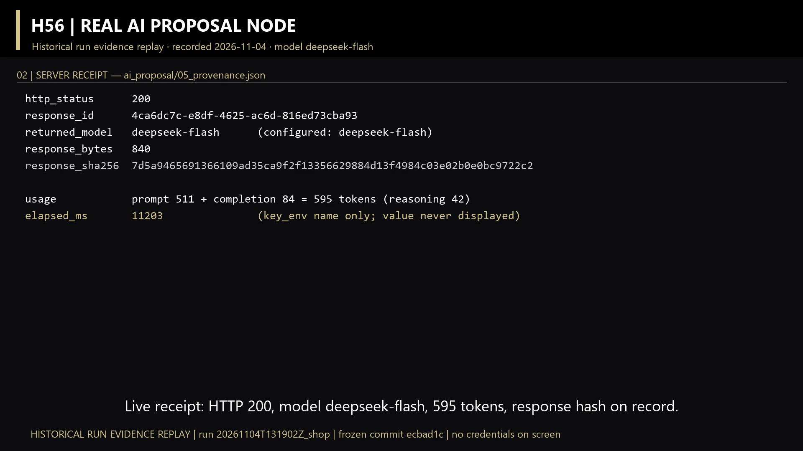
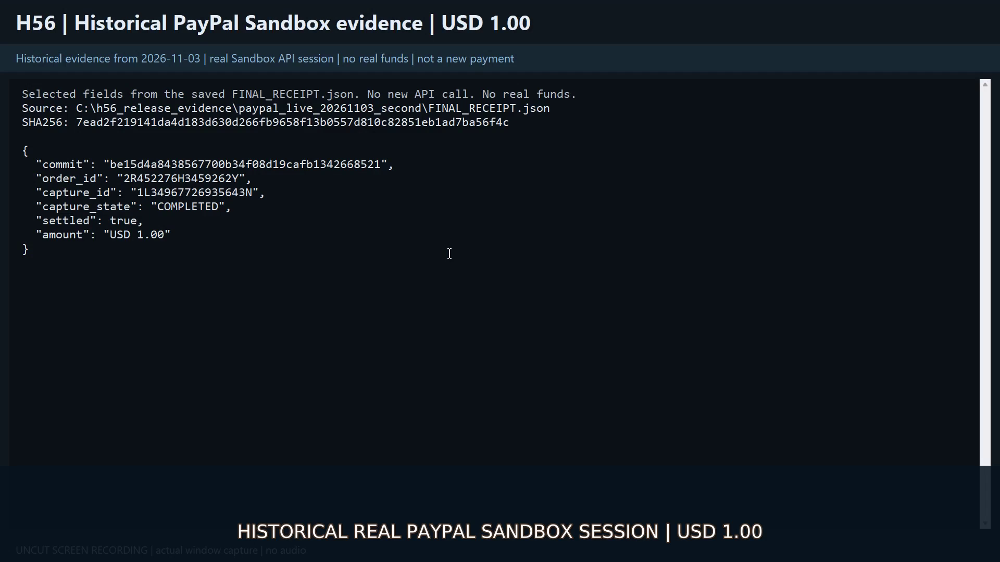

# H56 PayPal

**Deterministic governance for AI payment workflows.**

[Watch the 2:55 demo](https://youtu.be/KAn8YssR1hg) ·
[Run the examples](docs/DEMO_GUIDE.md) · [Installation guide](docs/RECOVERY_GUIDE.md)

H56 PayPal gives developers a controlled workflow for AI-assisted purchases. A model
drafts an order, payment rules check its business terms, H56 computes a host-eligibility
decision, and the buyer approves through PayPal Sandbox. CLI commands manage the
workflow; a local evidence console brings its decisions and receipts together.

The workflow checks price, recipient, evidence age and buyer approval before Capture.
Named stop reasons and saved records help an operator inspect the outcome and resume
an existing operation when appropriate.

## What you can do

| Capability | What the application provides |
| --- | --- |
| Generate a purchase proposal | An HTTPS model provider produces a structured order from the controlled catalogue, with a saved service receipt and token usage. |
| Check the business terms | Payment rules validate the per-order limit, catalogue offer, logical payee, price and currency. |
| Compute host eligibility | H56 runs K0 facts/history, K1 derived state, C1 capability contracts and C2 candidate feasibility on structured host evidence. |
| Complete a Sandbox checkout | The executor creates and queries orders, checks buyer approval and server-held order details, and records Capture status. |
| Inspect and verify a decision | The evidence console shows related runs and native records; the CLI verifier checks the saved order, request, evidence and assessment binding. |

## Workflow



## Recorded results

| Exercise | Recorded outcome | Date |
| --- | --- | --- |
| Real DeepSeek proposal | `deepseek-flash` drafted `S-C01 / 100 / USD`; payment policy `ALLOW`, H56 `FEASIBLE`, 22 native calls and successful binding verification. The receipt records 511 input + 84 output tokens. | Nov 4, 2026 |
| Real PayPal Sandbox operation | USD 1.00 Capture `COMPLETED` after browser approval and server-side order verification, with three saved host assessments. | Nov 3, 2026 |

The [demo video](https://youtu.be/KAn8YssR1hg) presents these records alongside working
CLI examples and refusal cases. Their session coverage and input grade are described
in [Scope and evidence](#scope-and-evidence).

## Run your first assessment

Use Windows with Python **3.9.13** or **3.13.12**, the verified interpreter versions.
The sample assessment uses the standard library and the included computation sources.
Choose a short checkout path and a fresh environment. In PowerShell 5.1 or newer:

```powershell
$repoUrl = 'https://github.com/wan593315006/H56-PayPal-Hackathon.git'
git -c core.longpaths=true clone $repoUrl C:\h56demo
if ($LASTEXITCODE -ne 0) { throw 'Clone failed' }
Set-Location C:\h56demo

py -3.9 -m venv C:\h56env
$PY = 'C:\h56env\Scripts\python.exe'
& $PY -B -m app.main selfcheck
if ($LASTEXITCODE -ne 0) { throw 'Self-check failed; see docs/RECOVERY_GUIDE.md' }

$stamp = [DateTime]::UtcNow.ToString("yyyyMMdd'T'HHmmss'Z'")
& $PY -B -m app.main evaluate --offer-id S-C01 --order-id O-DEMO --stamp $stamp
if ($LASTEXITCODE -ne 0) { throw 'Evaluation stopped; inspect its named reason' }
& $PY -B -m app.main verify --stamp $stamp --business shop
if ($LASTEXITCODE -ne 0) { throw 'Binding verification failed' }

& $PY -B run_offline_tests.py
```

Expected: `FEASIBLE`, 22 native calls, `BIND_FINDINGS=0` and `VERIFY_EXIT=0`.
If selecting Python 3.13, create the environment with `py -3.13`. Keep `-B` on project
commands to preserve the core's exact file set. Use a fresh stamp for each new run.

The [installation guide](docs/RECOVERY_GUIDE.md) covers environment setup, source
verification and troubleshooting. The [demo guide](docs/DEMO_GUIDE.md) walks through
policy refusals, host refusals, a model proposal and a buyer-approved Sandbox purchase.

## Use the service integrations

For a model-backed proposal, use `propose-ai --provider remote`. It saves the model's
answer, parsed order, validation and provenance, then evaluates the proposal through
the payment policy and H56. The operator selects Sandbox execution through the
`sandbox` commands and approves the order in PayPal's browser flow.

Follow the [demo guide](docs/DEMO_GUIDE.md) for the two service exercises and
[credential guide](docs/CREDENTIALS.md) for configuration. Model keys use a process
environment variable such as `H56PAY_MODEL_KEY`; the optional
[.env.example](.env.example) template covers PayPal configuration. All routes use the
Python standard library and bundled core; `requirements.txt` records this dependency
policy. Configure the selected service's credentials before its exercise.

## Review decisions and receipts

The local evidence console displays saved orders, policy outcomes, native verdicts,
record references and detected inconsistencies. Create assessments and run Sandbox
operations through the CLI, then refresh the console to review their records:

```powershell
& $PY -B ui/server.py --port 8848
```

Open `http://127.0.0.1:8848/`, enter the server's printed token and load the runs or
records view. See the [UI guide](ui/README.md) for the available views and local access
controls.

*Video still: archived DeepSeek service receipt, November 4, 2026.*



*Video still: archived PayPal Sandbox receipt, November 3, 2026.*



## Scope and evidence

| Area | Current scope |
| --- | --- |
| Host evidence | The demonstration uses the fixed `SYNTHETIC_ONLY` contract. The native cores evaluate supplied host facts; this build uses synthetic inputs rather than a live host-attestation collector. |
| Recorded service sessions | The November 4 DeepSeek record covers model proposal through assessment and binding. The November 3 Sandbox record covers a catalogue order through buyer approval and Capture. These are two recorded sessions; a same-session live-model-to-Capture run is outside the published evidence set. |
| Qualification and approval | `FEASIBLE` describes host eligibility. Payment policy validates business terms, and PayPal supplies the independently checked buyer-approval state. |
| Video and screenshots | The video combines CLI recordings with labelled historical evidence views. The screenshots above reproduce saved receipts from those views. |
| Console and commands | The console is a read-only record viewer. CLI commands create assessments and perform the explicitly selected Sandbox steps. |
| Payment environment | The executor uses PayPal Sandbox and simulated funds. |

Preserve `runs/<stamp>_shop/` together with its referenced `records/<session>/` when
archiving a decision. The run holds request, evidence, result and binding; the native
session holds the assessment, claim and event journal. AI runs also include the five
files in `ai_proposal/`.

## Project origins and hackathon work

H56 PayPal builds on our earlier H56 governance research. During this hackathon we
created the payment application in a separate repository, retaining the four native
cores and adding the payment policy, order binding, model provider, Sandbox executor
and evidence console.

| Date | Payment-project addition | Commit |
| --- | --- | --- |
| Nov 3 | Independent package assembly and source-identity checks | `5d5fb3c` |
| Nov 3 | Payment policy, controlled catalogue and native-core bridge | `dcecd08` |
| Nov 3 | Catalogue-price enforcement and order/assessment binding | `5940551` |
| Nov 3 | Recovery, replay and a read-only evidence console | `bd0aa9e` |
| Nov 3 | PayPal Sandbox order, approval-state and Capture integration, followed by execution-gate hardening | `b3221fa` through `be15d4a` |
| Nov 4 | Reproduction instructions, dependency compatibility and English UI text | `c8732e0` through `86e20a4` |
| Nov 4 | Structured AI proposals, service receipts and input-boundary checks | `8115047` through `ecbad1c` |

The table records Git check-in dates. The reused core's source identities and member
hashes are recorded in [VENDORED.md](VENDORED.md).

## Engineering verification

The included core contains **139 computation members plus their source declaration**.
`selfcheck` verifies their file set and hashes, checks the fixed assets, runs 30 native
cases and exercises cold imports. The complete application baseline `ecbad1c` passes
**263 offline tests** through `run_offline_tests.py`, with zero attempted Python network
calls in the guarded process.

The video retains CLI footage from `86e20a4` with its 186-test result. Its later AI
evidence segment uses `ecbad1c`; the historical Sandbox session used `be15d4a`. The
recordings preserve their original version labels.

For an offline test of the AI proposal interface, use the deterministic Mock provider:

```powershell
$aiStamp = [DateTime]::UtcNow.ToString("yyyyMMdd'T'HHmmss'Z'")
& $PY -B -m app.main propose-ai --provider mock --stamp $aiStamp --host-key hostAI01
& $PY -B -m app.main verify --stamp $aiStamp --business shop
```

This fixture proposes `S-C02` at USD 25.00 and records `provider=mock`. It exercises the
proposal interface, payment rules, native cores and binding locally, without contacting
a model service or PayPal.

## Repository layout

| Path | Purpose |
| --- | --- |
| `h56_core/` | Native cores, vendor dependencies and source declaration. |
| `app/` | Proposal handling, payment policy, binding, recovery and Sandbox integration. |
| `fixtures/catalog.json` | Sample offers, prices, currencies and logical payees. |
| `ui/` | Local evidence console. |
| `tests/`, `run_offline_tests.py` | Regression cases and the guarded test entry. |
| `docs/` | Demo, credential and installation instructions. |
| `VENDORED.md`, `.gitattributes` | Source provenance and byte-preservation policy. |

The checkout supplies the complete source for local execution. Runtime outputs,
credentials and private development evidence stay outside the public distribution.

## Development direction

Next steps are versioned host-evidence collectors, richer payment contracts and a
guided operator workflow that keeps proposal, qualification, approval and execution
explicit.

## License

Copyright (c) 2026 万根. Distributed under the complete [MIT License](LICENSE).
[IP_NOTICE.md](IP_NOTICE.md) contains the accompanying intellectual-property notice.
