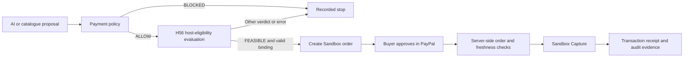

# H56 PayPal

**Deterministic governance for AI payment workflows.**

**Demo video:** [Watch the 2:55 demonstration on YouTube](https://youtu.be/KAn8YssR1hg).

H56 PayPal separates a model's purchase proposal from the checks and approval required
to execute it. An independent payment policy checks the business terms, H56 evaluates
host eligibility, and PayPal Sandbox records the buyer's approval and payment outcome.
Each stage leaves an inspectable record.

A plausible proposal can still name the wrong price, arrive with stale evidence, or
precede buyer approval. H56 makes those conditions separate decisions rather than one
model-generated answer.

## How it works



| Layer | Responsibility |
| --- | --- |
| AI proposal | Drafts a JSON order using the controlled catalogue. Its output passes structure and credential-echo checks before use. |
| Payment policy | Checks a positive integer amount, the per-order limit, catalogue membership, the payee allowlist, and the exact catalogue price and currency. |
| H56 native cores | K0: facts and history; K1: derived state; C1: capability contracts; C2: candidate feasibility. This build uses a fixed **synthetic host-evidence contract**. |
| PayPal executor | Creates and queries Sandbox orders, requires buyer approval, verifies the server-held order, and reports the Capture outcome. |

`FEASIBLE` is a host-eligibility result. Payment policy and buyer approval remain
independent requirements. A policy stop records `BLOCKED` with `h56_invoked=false`;
it does not claim a native-core verdict.

CLI steps make execution explicit. `propose-ai` stops after saving its governance
result; the operator separately selects the Sandbox steps.

## Start without credentials

Verified Windows configurations: Python **3.9.13** and **3.13.12**. The offline route
uses the standard library and the included source closure. Use a short checkout path
because some vendored paths are long.

In PowerShell 5.1 or newer:

```powershell
$repoUrl = 'https://github.com/wan593315006/H56-PayPal-Hackathon.git'
git -c core.longpaths=true clone $repoUrl C:\h56demo
if ($LASTEXITCODE -ne 0) { throw 'Clone failed' }
Set-Location C:\h56demo

py -3.9 -m venv C:\h56env
$PY = 'C:\h56env\Scripts\python.exe'
& $PY -B -m app.main selfcheck
if ($LASTEXITCODE -ne 0) { throw 'Self-check failed; see docs/RECOVERY_GUIDE.md' }

$stamp = [DateTime]::UtcNow.ToString("yyyyMMdd'T'HHmmss'Z'")
& $PY -B -m app.main evaluate --offer-id S-C01 --order-id O-DEMO --stamp $stamp
if ($LASTEXITCODE -ne 0) { throw 'Evaluation stopped; inspect its named reason' }
& $PY -B -m app.main verify --stamp $stamp --business shop
if ($LASTEXITCODE -ne 0) { throw 'Binding verification failed' }

& $PY -B run_offline_tests.py
```

If Python 3.13 is your installed version, use `py -3.13` when creating the environment.
Keep `-B` on project commands: generated byte caches change the pinned core file set.

For the unchanged sample catalogue, the evaluation returns `FEASIBLE` with 22 native
calls, and `verify` returns `BIND_FINDINGS=0` / `VERIFY_EXIT=0`. The code baseline
`ecbad1c` has **263 offline tests**. The guarded test entry reports network attempts
separately and succeeds only when tests pass with zero attempted Python network calls.

Use a fresh stamp for each new run. A taken stamp is refused rather than reused.
The [recovery guide](docs/RECOVERY_GUIDE.md) explains setup, integrity checks, outputs,
and troubleshooting. The [demo guide](docs/DEMO_GUIDE.md) includes positive and negative
examples and their expected results.

## Choose an exercise

| Route | Credentials / network | What you can inspect |
| --- | --- | --- |
| Catalogue evaluation | None; offline | Business policy, synthetic host evidence, native verdict, and binding verification. |
| Mock AI proposal | None; offline | The proposal interface and the same downstream policy/core chain, using a deterministic stand-in. |
| Remote AI proposal | Your model API key; one model request | Model text, parsed proposal, validation, service receipt, usage, and the downstream result. |
| PayPal Sandbox | Your Sandbox app and buyer account; PayPal API calls | Order creation, personal browser approval, server-side checks, Capture, and receipts. |

For an offline AI-interface example:

```powershell
$aiStamp = [DateTime]::UtcNow.ToString("yyyyMMdd'T'HHmmss'Z'")
& $PY -B -m app.main propose-ai --provider mock --stamp $aiStamp --host-key hostAI01
& $PY -B -m app.main verify --stamp $aiStamp --business shop
```

The mock names catalogue offer `S-C02` at USD 25.00. This command evaluates a proposal;
it does not create a PayPal order. For a real model call and the separate Sandbox
exercise, follow the [demo guide](docs/DEMO_GUIDE.md) and
[credential guide](docs/CREDENTIALS.md).

The model key is read from a process environment variable such as `H56PAY_MODEL_KEY`.
The optional `.env` file is reserved for the three PayPal configuration names listed in
[.env.example](.env.example). API-mode environment setup uses
`python -m pip install -r requirements.txt`; use your selected environment's interpreter.

## Inspect the results

`runs/<stamp>_shop/` contains the request, evidence, result and binding. An AI run adds
`ai_proposal/`: prompt, answer text, parsed proposal, validation and provenance.
`records/<session>/` holds the native assessment, claim and event journal. Keep both
directories together when preserving a run for later verification.

Start the read-only evidence UI:

```powershell
& $PY -B ui/server.py --port 8848
```

Open `http://127.0.0.1:8848/`, enter the local run token printed by the server, and load
the runs or records view. The UI reads saved results; commands create evaluations and
perform Sandbox actions. See [ui/README.md](ui/README.md).

## Recorded demonstrations

| Recorded run | Result | Code used |
| --- | --- | --- |
| 2026-11-03 PayPal Sandbox | USD 1.00 Capture `COMPLETED`, following browser approval and server-side verification; three saved host assessments. | `be15d4a` |
| 2026-11-04 DeepSeek | `deepseek-flash` drafted `S-C01 / 100 / USD`; policy `ALLOW`, H56 `FEASIBLE`, 22 calls, independent binding verification passed; usage 511 input + 84 output tokens. | `ecbad1c` |

These are separate recorded sessions. The model-only run made zero business-action
calls. The Sandbox run used simulated funds. Host facts in this demonstration are
labelled `SYNTHETIC_ONLY` in the evidence contract.

The following stills are **historical evidence views from the demo video**, rather than
new requests or the interactive UI:


The published demo video retains historical CLI footage from `86e20a4` and its 186-test
snapshot, and adds the later AI evidence from `ecbad1c`. Each segment retains its source
identity. Current repository test results are reported independently of that footage.

## Project origins and hackathon updates

H56 PayPal builds on our existing H56 governance research and published computation
core. The reused core is byte-pinned in [VENDORED.md](VENDORED.md), with source release
`83484f79ad387296e623376f41b84bf1fb20d8ba` and upstream core identity
`9221e16460258bc81e1176d69f63a09f81159b73`.

During the PayPal AI Hackathon, we developed the payment application in a separate
repository. The implementation history records these additions on November 3–4, 2026:

| Date | Payment-project addition | Commit |
| --- | --- | --- |
| Nov 3 | Independent package assembly and source-identity checks | `5d5fb3c` |
| Nov 3 | Payment policy, controlled catalogue and native-core bridge | `dcecd08` |
| Nov 3 | Catalogue-price enforcement and order/assessment binding | `5940551` |
| Nov 3 | Recovery, replay and a read-only evidence console | `bd0aa9e` |
| Nov 3 | PayPal Sandbox order, approval-state and Capture integration, followed by execution-gate hardening | `b3221fa` through `be15d4a` |
| Nov 4 | Reproduction instructions, dependency compatibility and English UI text | `c8732e0` through `86e20a4` |
| Nov 4 | Structured AI proposals, service receipts and input-boundary checks | `8115047` through `ecbad1c` |

The four native cores remain unchanged. The contribution of this submission is the
payment-specific application, its explicit decision boundaries and its inspectable
integration evidence. Dates above are Git check-in dates.

## Repository map

| Path | Purpose |
| --- | --- |
| `h56_core/` | 139 pinned computation members plus `SOURCE_MANIFEST.json`; includes the vendor closure. |
| `app/` | Proposal handling, payment policy, binding, recovery and Sandbox integration. |
| `fixtures/catalog.json` | Authoritative sample offers, prices, currencies and logical payees. |
| `ui/` | Standard-library, read-only evidence console. |
| `tests/`, `run_offline_tests.py` | Engineering regression tests and the guarded test entry. |
| `docs/` | Demo, credential and recovery instructions. |
| `VENDORED.md`, `.gitattributes` | Provenance and byte-preservation policy. |

Runtime data, credentials and internal construction scripts are kept outside the public
source distribution. The source checkout contains everything required for the no-key
route; it has no separate slice-activation step.

## Development direction

Next development directions are versioned host-evidence collectors, richer payment
contracts, and a guided operator workflow that preserves the same separation between
proposal, eligibility, authorization and execution.

## License

Copyright (c) 2026 万根. Distributed under the complete [MIT License](LICENSE).
[IP_NOTICE.md](IP_NOTICE.md) records the intellectual-property notice without modifying
the MIT terms.
